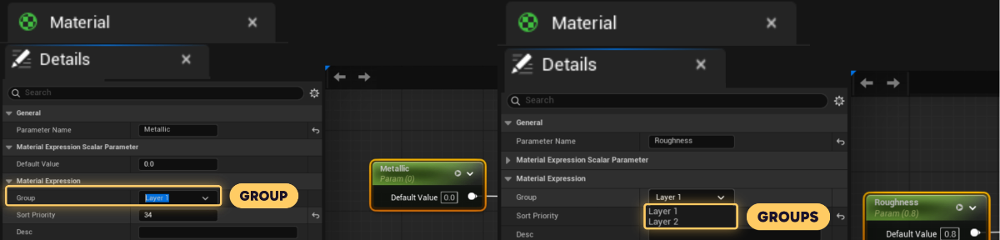
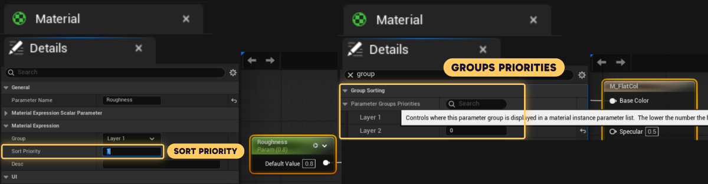
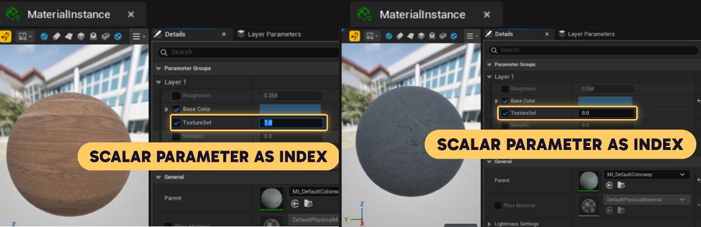
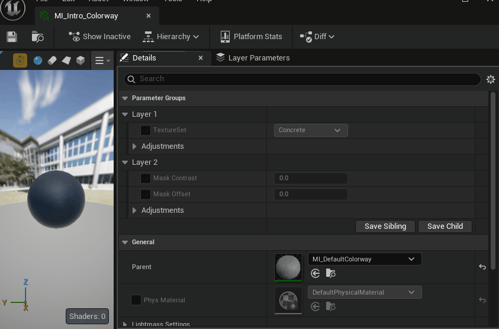
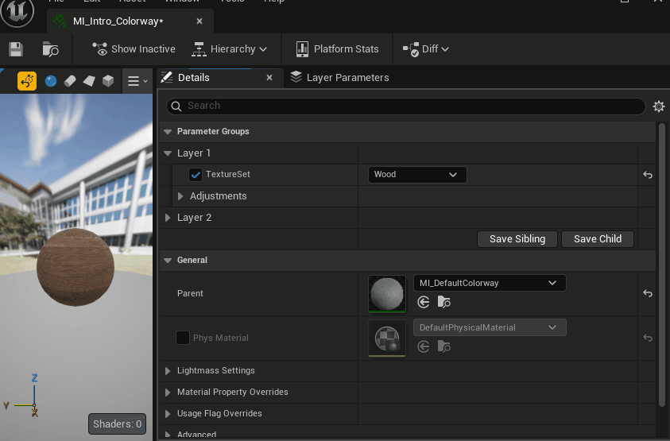
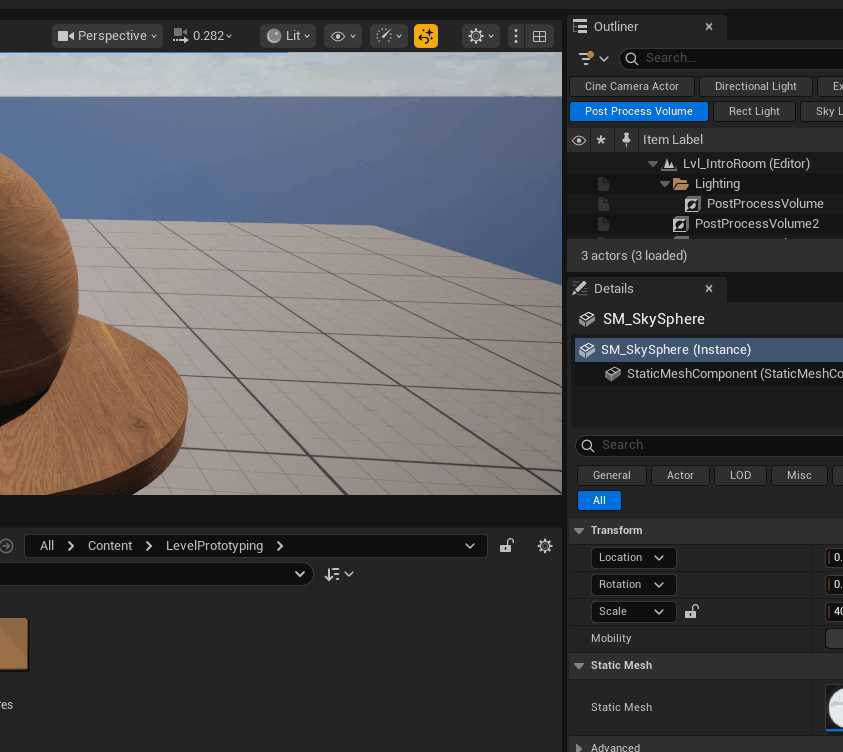

# Quick Tips: Unreal 5.7 Material UI Tips

by  [Bram Tempelaere](https://www.artstation.com/bramtempelaere) on 9th Nov 2026

Hello, my name is Bram Tempelaere, I’m a technical environment artist and work with materials in Unreal Engine at Day III Digital. While building and using large, layered master materials, together with my colleague Ward Vervoort, we found two easy-to-miss features that can make material instances much easier to navigate: **parameter subgroups** and **text dropdowns** for scalar parameters. In this article, I’ll show how they work and how they can help keep complex materials more organized and artist-friendly.


Have you ever ran into the issue of opening up a material instance and just being hit by a list of parameters? It is a common issue for big materials. Unreal gives you some tools to organise them, like parameter grouping and setting a sort priority per parameter and group to reorder them. But this can often not be enough if your material contains multiple layers, masks for those layers and adjustment settings per layer.

Another common trope when building a material is using a scalar parameter as an index to choose between different hardcoded options within your graph. This can be useful to mask between states/ textures or world position offset animations to play for example. One annoyance with this I’ve found is there’s no clear way to communicate what each index corresponds to so the artist ends up scrolling the float in the UI to find the right option.

While not a hard requirement to make things work, having a nicer UI can elevate the ease of use for your material and make it more easily approachable for new artists using the material!

## Well Known Material UI Organisation Features

The parameter group can be set in the details panel of the selected parameter node. Once a group has been assigned to one parameter, you can also find it in the dropdown under other parameters.



A sort priority can also be set on a parameter which changes the order of parameters within its group.  To change the sort order for the groups, you can go into the materials details panel and search for group sorting.
( →click off any node, into the grid or on the brown material output node).



In a material-layering setup, every layer has its own colour, normals, roughness, blend settings and tiling, and it adds up fast. With flat groups, I end up scrolling through a long list of `L1 Base`, `L1 Adjustments`, `L2 Base` and so on. This matters even more for the artists using these materials, as most of them never open the master and only ever see the instance. A second issue I ran into is with using a scalar as an index for my material ( to switch between textures on an atlas for example): The only way to see what you’re selecting is by looking at your material or being familiar with what index corresponds to what entry. This can be quite unintuitive to a new user of your material.



## Parameter Subgroups

Introducing subgroups, with subgroups I can collapse every layer feature not being worked on, which keeps the instance readable even on the biggest masters. I also use them to create a distinction between the most impactful and more granular parameters, so the top-level group stays focused on attributes like selecting which texture set to use.



*Parameter Subgroups hierarchy keeping things more organised*

### How to set up Parameter Subgroups

To nest groups, I put a `|` in the Group field of a material parameter (Scalar, Vector, Texture, etc.). Instead of naming a group `Layer 01 Adjustments`, I name it `Layer 01|Adjustments`. In the Material Instance Editor, this creates a collapsible header for `Layer 01`, with a second collapsible header for `Adjustments` nested inside it.

For a layered master, my groups look like this:

```
Layer 01
Layer 01|Adjustments
Layer 02
Layer 02|Adjustments
```

[parametersubgroupstutorial.mp4](parametersubgroupstutorial.mp4)

Something to note here is that group names are CAPS sensitive. If one parameter sits in `FX|Fire` and another in `Fx|Fire`, the editor creates two separate top-level groups.

Once we noticed nobody on the team knew about this feature, we went looking for documentation. As we couldn’t find anything written down, my colleague Ward Vervoort searched through the engine source on GitHub. As far as he could tell, it went in with Unreal Engine 5.7 (see Sources below).

## Text Dropdowns on Scalar Parameters

The second feature is just as easy to miss. To replace a plain scalar value with text, you can assign an Enum asset to a Scalar Parameter, and the material instance shows a dropdown with the Enum entries instead.

The scalar parameter remains a scalar. The UI simply maps each Enum entry to an integer value (0, 1, 2, etc.). The branching logic still has to be built in the Material Graph.

In this example I use the text dropdown to switch between my texture indices on my texturearray

```
Concrete
Wood
```



*An Enum-driven scalar parameter in a material instance.*

### How to setup Text Dropdowns on Scalar Parameters

1. Create an Enum asset by right clicking in your contentbrowser, searching for Enum and adding entries into it.
2. **Selection:** in the Scalar Parameter's Details panel, set the Enum property to your Enum asset.
3. **Use as an index:** compare the scalar against the index you want to branch on, or use it directly as an index into f.e. a texture-array.



*How to set up an Enum dropdown*

Now you see the Enum entries as options on a dropdown in the Material Instance UI!

This way, artists pick a named entry from a list instead of having to remember which number does what.

When the material gets compiled, there’s 0 difference when using an Enum vs when not using an Enum. So it’s fully UI-sided and doesn’t bring any runtime costs.

## Wrap-up

Both features take a couple of minutes to set up, and on a big layered master the difference is huge. If you are on Unreal Engine 5.7 or newer, I recommend implementing subgroups on your bigger masters, and giving your "state" scalars an Enum while you are at it. On top of being handy for the shader artist testing it, it can also make it easier for artists to adopt your shader as they don’t need to memorise indices.

I'm always happy to hear how others keep their big masters readable, so feel free to comment and share your tricks!

## Sources

- [*[Link to the commit on GitHub]*](https://github.com/EpicGames/UnrealEngine/pull/13442#pullrequestreview-2948227338)
