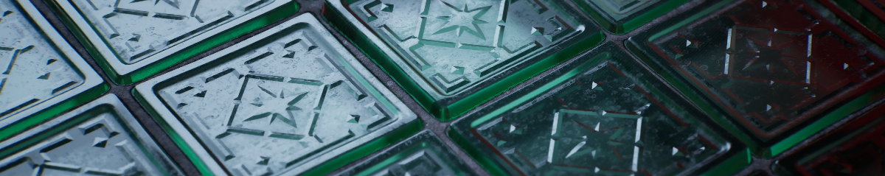

# Nanite Translucency: Refraction Through Reflections

by [Leo Newman](https://www.artstation.com/leo_newman) on 15th Oct 2026

Hello, my name is Leo Newman, and I’m a senior lighting contractor currently at Day III Digital. Besides lighting, I find myself dabbling in shaders more often than not. In this article, I want to share some exciting findings related to a fake translucency shader I created. Over the past few months, I have been perfecting the shader’s features, with some help from my colleague Ward Vervoort. The method consists of a fully opaque shader (Nanite) with no need for cube maps or emissive trickery, while still delivering convincing translucent results. It also supports refraction, blurred refraction, and coloured tinting.

Translucent materials in Unreal come with a familiar list of drawbacks: sorting problems, no depth write, poor lighting and reflection support, fiddly depth of field behaviour and no nanite or tessellation. Keeping the glass material opaque fixes all of that.

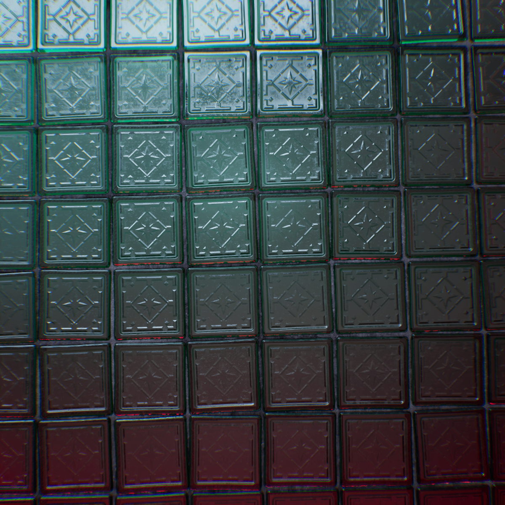

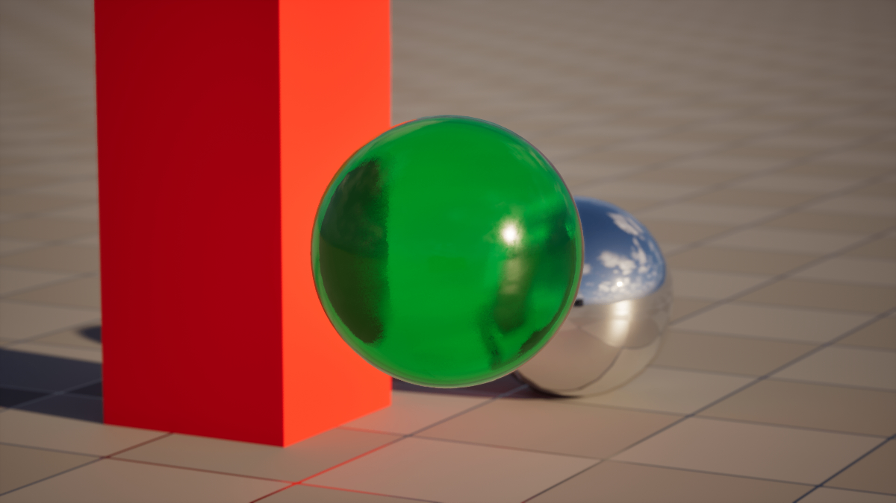

[Fake_Translucency_Showcase.mp4](Fake_Translucency_Showcase.mp4)

Seems impossible, so how is this done?

## Reflection as refraction

A perfect metallic (mirror) surface sends an incoming view ray off in exactly one direction, and that direction is usually determined by the surface normal. But really, you can send the ray anywhere you’d like, including straight through the surface in the direction it would be refracted by real glass. Basically, all I’m doing is leveraging Lumen reflections to return the scene behind the surface. Let’s have a look at how this is done:

For this to work, you’ll need to do a few things:

- Substrate needs to be on with Adaptive GBuffer.
- In the post process settings, disable Lumen Reflections Screen Traces.
- Disable “Visible in Ray Tracing” (or “affect distance field lighting” if using software lumen) in the mesh’s settings
- Uncheck “Cast Shadow” in the mesh’s settings
- Optional: In the project settings, enable “Hit Lighting for Reflections” under “Ray Lighting Mode”,  this will make the effect look better. In addition, set Max Reflection Bounces to 2 in the PPV Lumen Reflection settings. This will make metallic objects shade correctly behind the object.

Different Lumen settings compared:

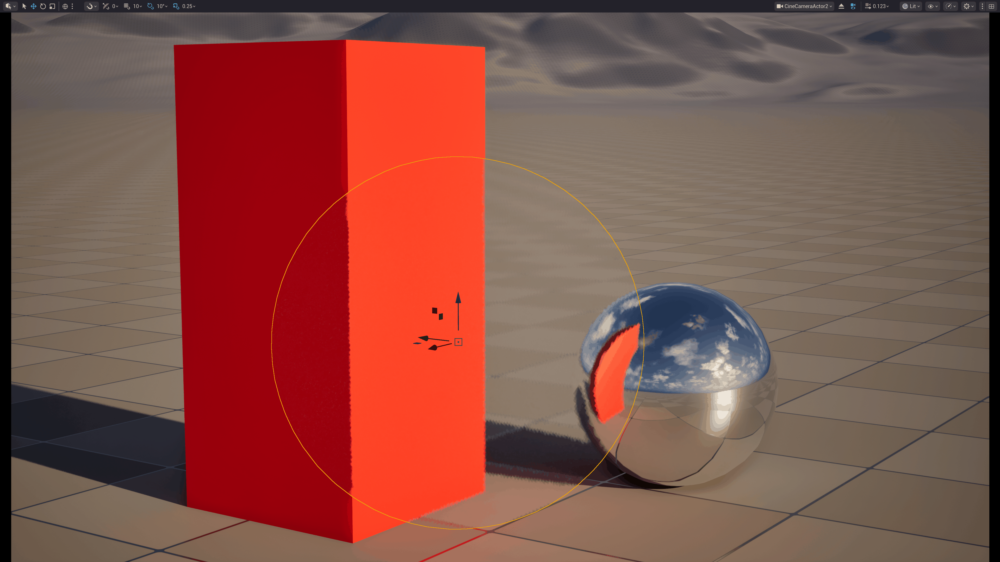

The setup for now is simple: a single opaque Substrate slab with the albedo set to 0 and a tint parameter on the F0 and F90 controlling the translucent colour. The key here is the normal input. The Camera Vector gives the world-space direction from the pixel toward the camera, creating the “fake translucency.”

[Tint Controls](2026-10-07_21-45-53_-_Trim.mp4)

Tint Controls

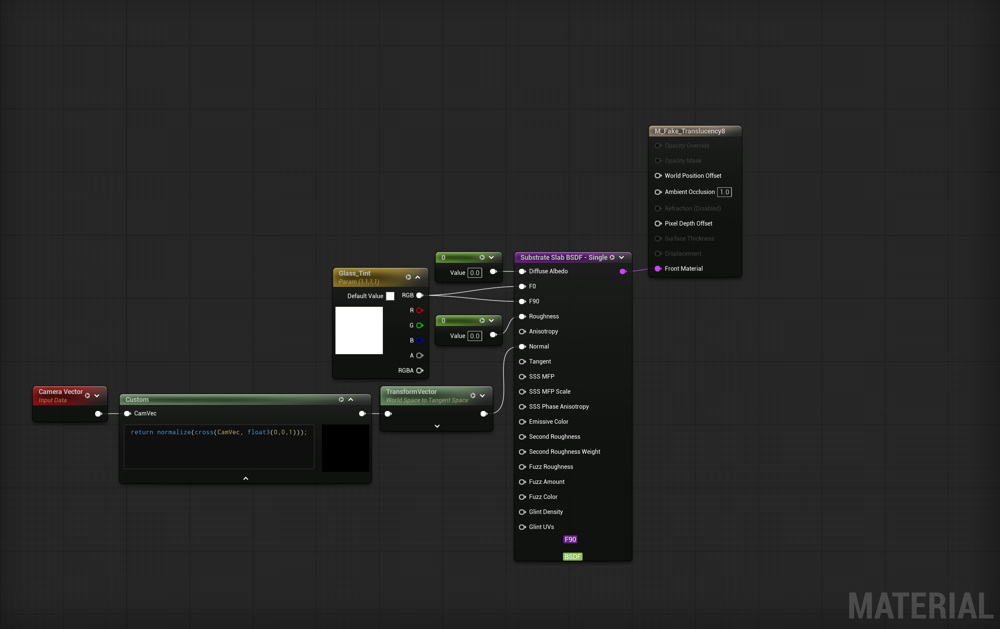

Our sphere is looking a little flat. Real glass spheres bend light (refraction), so let’s add that.
Here are the new inputs:

- **NormalWS.** A tangent-space normal that needs to be  transformed from Tangent to World space.  At the moment, nothing is perturbing it, this is just the mesh’s surface normal in world space.
- **IOR.** Set to 1.54, which is about the value for crown glass.
- **Strength.** This is a way to control the intensity of the refraction. For a sphere, I’m using a Fresnel. A Lerp chooses between that Fresnel value  and a constant.

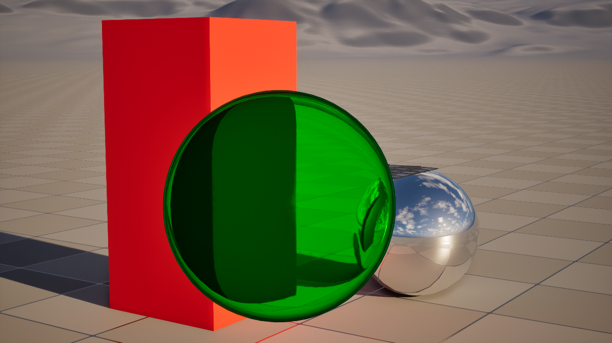

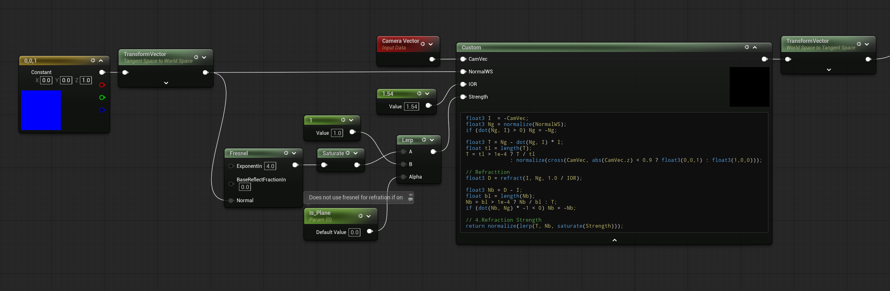

Better! Now we’re still missing lighting on the glass sphere, lets add that too:
For this I add a second substrate slab using the substrate add node. This slab will layer the sky specular and direct light specular back onto the sphere, by using the regular geo normal. We will add roughness variation and dirt to this same layer later on.

[Glass_Sphere_Breakdown.mp4](Glass_Sphere_Breakdown.mp4)

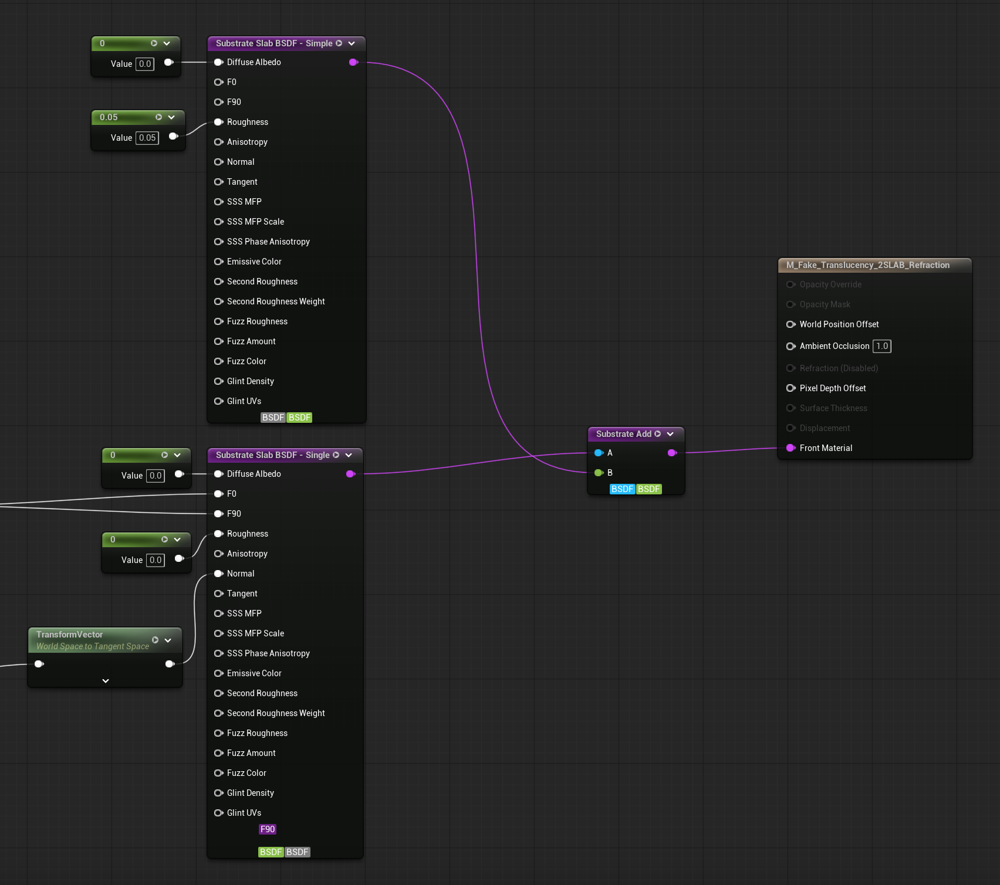

We’re almost there! The last feature to add, is rough refraction. Rough refraction here works by randomly wobbling the refracted ray a little differently for every pixel, every frame, and letting temporal AA average the noise into a blur.

[Glass_Ball_Turn_Around.mp4](Glass_Ball_Turn_Around.mp4)

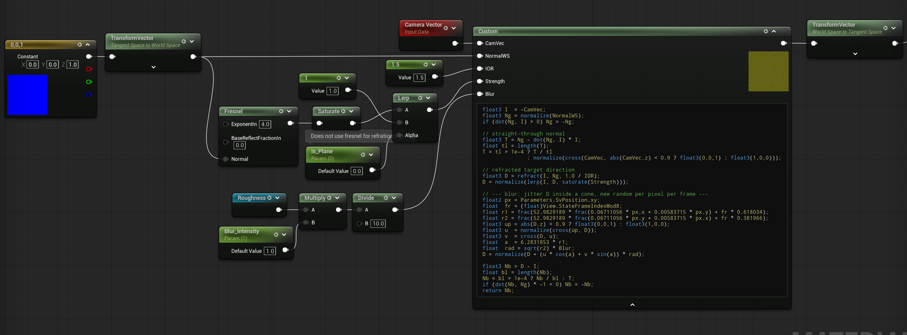

And here we go, this is the shader in it’s simplest form. To recap : 

- **The surface slab** carries everything you'd see on the glass itself, including dirt and roughness.
- **The "transmission" slab** is a pure mirror: Diffuse Albedo 0, Roughness 0. Its normal comes from the custom HLSL node. Because F0 and F90 are the same colour, the slab reflects with a flat tint at every angle, which reads as light passing through coloured glass rather than a Fresnel reflection.

---

## Application: Glass bricks material.

Now that it looks quite convincing, let’s apply this technique to something more complex. I decided to create a glass brick wall by creating some textures in Substance Designer. This will demonstrate the best use case for this shader trick. 

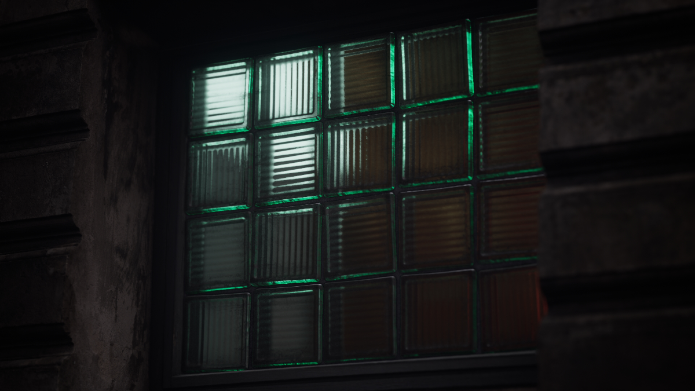

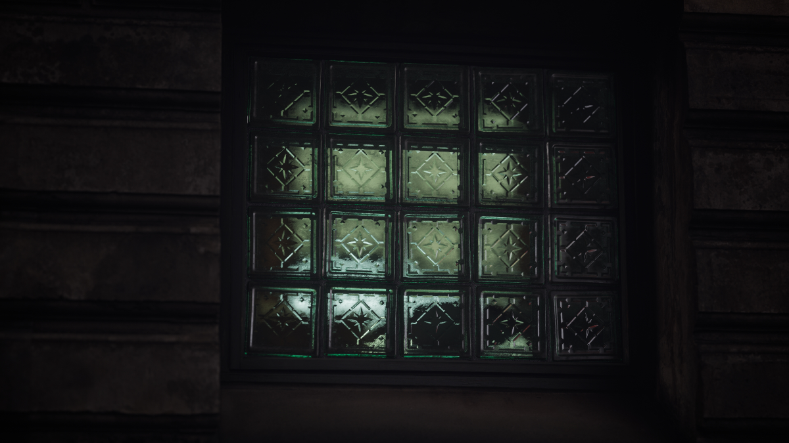

The material uses 2 textures: an rgb normal texture and a rgba mask texture.

- R= roughness
- G= material AO
- B= height
- A= dirt mask + grout mask

The roughness map is used to add the specular roughness of the glass material. But also to blur the background of the translucent slab. The height map is used with nanite displacement to extrude the glass cubes out. And the AO map is simply used in the material AOs material pin. The dirt mask is used to add dirt on the glass. This also reduces it’s translucency. In that same channel, a mask is used for the grout to remove translucency completely.

The mirror slab passes through a *Substrate Coverage Weight* before the *Substrate Add*, so it only appears where there is clean glass. On the grout and under heavy dirt, the surface slab alone shows.

Lastly, let’s add some kind of fake interior, because this material is opaque, it does not understand the materials' depth. To make it look more convincing, the grout should show up on the inside perimeter of the glass, for this I use some additional HLSL code to create a parallax mask for each tile.

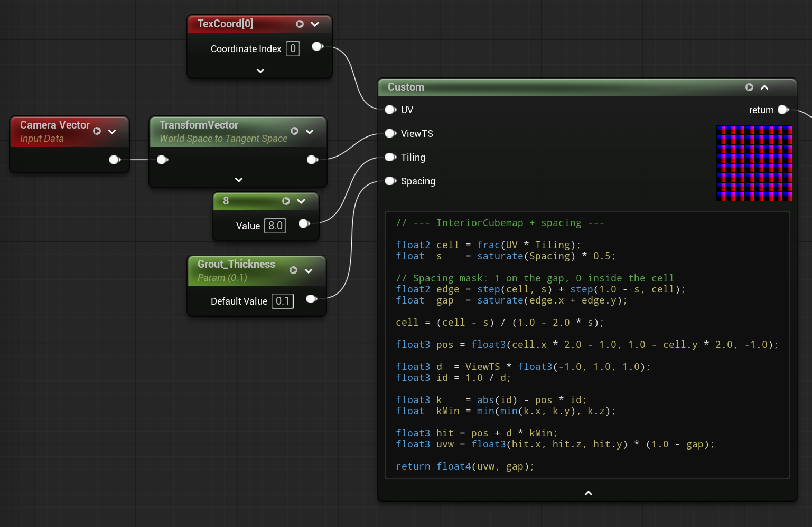

Here is a breakdown of the different effects layered together:

[Glass_Blocks_Breakdown.mp4](Glass_Blocks_Breakdown.mp4)

Different normal/height maps can distort the background differently:

---

## Pros and cons

**Here are some of the benefits of using this method:**

- Supports DOF,
- Supports complex light reflections (rect lights etc.),
- Does not use any emissive trickery and is physically accurate,
- Supports advanced and expensive translucent effects: refraction, blurred refraction and coloured tinting,
- Supports nanite geometry and nanite displacement,
- Supports material AO.

**While this cool, it’s not perfect. Here are some drawbacks:**

- Relies on lumen scene for translucent effect,
- Requires lumen screen space to be turned off, otherwise strange artifacts can appear,
- Cannot display interior geometry or two-sided geometry,
- Requires 2 substrate slab BSDF,
- Substrate needs to be on with Adaptive GBuffer.
